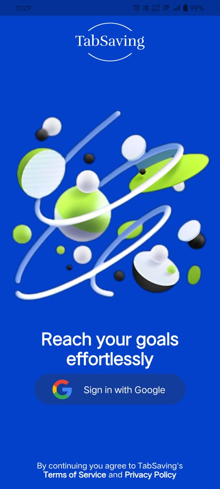
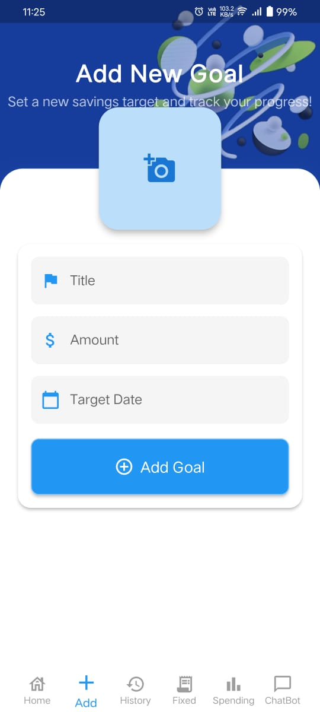
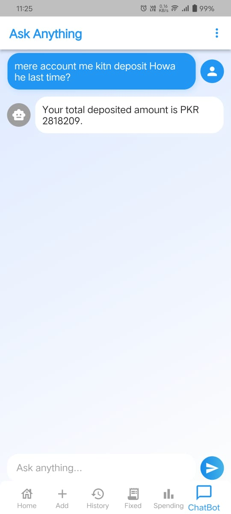
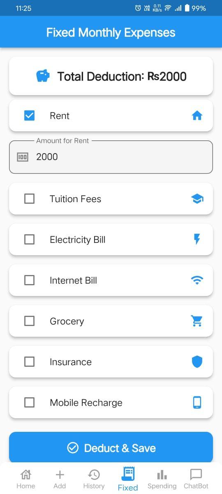
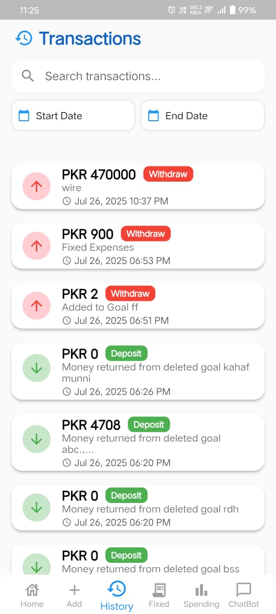
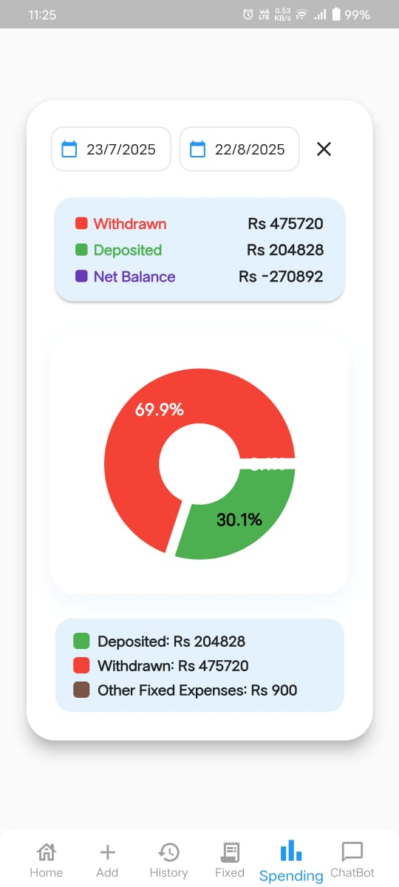

# <p align="center">
  
</p>

<p align="center">
  <strong>Savings Flutter App</strong><br />
  A modern Flutter application with Firebase integration for seamless authentication, product listing, order management, chat, and responsive UI.
</p>

<p align="center">
  
  
  
  
  
</p>

---

## 🚀 Installation

```bash
git clone https://github.com/yourusername/savings.git
cd savings
flutter pub get
flutter run
```

---

## ✨ Features

- 🔐 Authentication with Firebase Auth
- 🛍️ Product Listing with Firestore & Realtime DB
- 📦 Order Management system
- 💬 Real-time Chat functionality
- 📱 Responsive UI for multiple screen sizes
- 🗺️ Google Maps integration
- 🔄 Persistent Navigation Bar for smooth navigation

---

## 📸 Screenshots

<p align="center">
  
  
  
</p>
<p align="center">
  
  
  
</p>

---

## 🛠️ Tech Stack

| Technology               | Description                          |
|--------------------------|------------------------------------|
| Flutter                  | UI toolkit for building natively compiled apps |
| Dart                     | Programming language for Flutter   |
| Firebase                 | Backend services (Auth, Firestore, Realtime DB, Storage) |
| Provider                 | State management                   |
| Google Maps              | Maps integration                   |
| Persistent Navigation Bar| Smooth bottom navigation           |

---

## 📖 Usage

1. Clone the repository
2. Run `flutter pub get` to install dependencies
3. Connect your Firebase project and configure `google-services.json` and `GoogleService-Info.plist`
4. Run the app on your device or emulator using `flutter run`

---

## 🤝 Contribution

Contributions are welcome! Please follow these steps:

1. Fork the repository
2. Create your feature branch (`git checkout -b feature/YourFeature`)
3. Commit your changes (`git commit -m 'Add some feature'`)
4. Push to the branch (`git push origin feature/YourFeature`)
5. Open a Pull Request

Please ensure your code follows the existing style and includes relevant tests.

---

## 📄 License

This project is licensed under the MIT License - see the [LICENSE](LICENSE) file for details.

---

## ⭐ Support

If you like this project, please give it a ⭐ on GitHub!
